# Architecture

```
┌──────────────────────────────────────────────────────────────────────────────────────────┐
│                                Single Binary                                             │
│                                                                                          │
│  ┌─────────────────────────────────────────────────────────────────────┐                 │
│  │                     Management API + Web UI  :9091                  │                 │
│  │  CRUD mocks/rules  ·  scenarios  ·  fault  ·  state  ·  logs/SSE    │                 │
│  └─────────────────────────────────────────────────────────────────────┘                 │
│                                                                                          │
│  ┌──────┐ ┌─────────┐ ┌──────┐ ┌─────────┐ ┌─────┐ ┌───────┐ ┌──────┐ ┌──────┐ ┌──────┐  │
│  │ HTTP │ │WebSocket│ │ gRPC │ │GraphQL  │ │ TCP │ │ Redis │ │ SMTP │ │ MQTT │ │ SNMP │  │
│  │:8080 │ │ :8081   │ │:50051│ │ :8082   │ │:8083│ │ :6379 │ │:2525 │ │:1883 │ │:1161 │  │
│  └──────┘ └─────────┘ └──────┘ └─────────┘ └─────┘ └───────┘ └──────┘ └──────┘ └──────┘  │
│                                                                                          │
│  Shared:  State Store  ·  Request Logger  ·  Scenario Store                              │
└──────────────────────────────────────────────────────────────────────────────────────────┘
```

## Component diagram

An AI-generated, auto-updating component diagram is available at
[gitdiagram.com/dever-labs/mockly](https://gitdiagram.com/dever-labs/mockly)
(interactive, with clickable nodes linking straight to source). The same
diagram, embedded here:

```mermaid
flowchart TD

subgraph group_entry["Entry Points"]
  node_cli["Mockly CLI<br/>[main.go]"]
  node_config["Configuration<br/>[config.go]"]
  node_presets["Preset Configs<br/>[presets.go]"]
end

subgraph group_management["Management"]
  node_ui["Web UI"]
  node_api["REST API<br/>[server.go]"]
end

subgraph group_runtime["Mock Runtime"]
  node_http["HTTP Server<br/>[server.go]"]
  node_wsgrpc["WS, gRPC, GraphQL"]
  node_messaging["Messaging Protocols"]
  node_otherproto["Other Protocols"]
end

subgraph group_shared["Shared Services"]
  node_engine["Matching &amp; Templates"]
  node_scenarios["Scenarios &amp; Faults"]
  node_state[("Runtime State<br/>[store.go]")]
  node_logs[("Request Logs<br/>[logger.go]")]
end

subgraph group_clients["Client Libraries"]
  node_sdk["Language Drivers"]
  node_containers["Testcontainers Integrations"]
end

node_operator(("Operator"))
node_app(("Test Application"))

node_operator -->|"runs commands"| node_cli
node_operator -->|"configures mocks"| node_ui
node_cli -->|"manages mocks"| node_api
node_cli -->|"loads config"| node_config
node_cli -->|"uses presets"| node_presets
node_cli -->|"starts listeners"| node_http
node_cli -->|"starts listeners"| node_wsgrpc
node_cli -->|"starts listeners"| node_messaging
node_cli -->|"starts listeners"| node_otherproto
node_config -->|"configures"| node_http
node_config -->|"configures"| node_wsgrpc
node_config -->|"configures"| node_messaging
node_config -->|"configures"| node_otherproto
node_ui -->|"calls endpoints"| node_api
node_api -->|"manages mocks"| node_http
node_api -->|"manages mocks"| node_wsgrpc
node_api -->|"manages mocks"| node_messaging
node_api -->|"manages mocks"| node_otherproto
node_api -->|"manages scenarios"| node_scenarios
node_api -->|"manages state"| node_state
node_api -->|"reads logs"| node_logs
node_app -->|"sends requests"| node_http
node_app -->|"sends traffic"| node_wsgrpc
node_app -->|"sends traffic"| node_messaging
node_app -->|"sends traffic"| node_otherproto
node_http -->|"matches and renders"| node_engine
node_wsgrpc -.->|"matches and renders"| node_engine
node_messaging -.->|"matches and renders"| node_engine
node_otherproto -.->|"matches and renders"| node_engine
node_http -->|"applies patches and faults"| node_scenarios
node_messaging -.->|"reads protocol faults"| node_scenarios
node_http -->|"checks conditions"| node_state
node_messaging -.->|"checks conditions"| node_state
node_http -->|"records calls"| node_logs
node_messaging -.->|"records traffic"| node_logs
node_sdk -->|"manages server"| node_api
node_sdk -.->|"supports tests"| node_app
node_containers -.->|"wraps server"| node_sdk

click node_cli "https://github.com/dever-labs/mockly/blob/main/cmd/mockly/main.go"
click node_config "https://github.com/dever-labs/mockly/blob/main/internal/config/config.go"
click node_presets "https://github.com/dever-labs/mockly/blob/main/internal/presets/presets.go"
click node_ui "https://github.com/dever-labs/mockly/tree/main/ui/src"
click node_api "https://github.com/dever-labs/mockly/blob/main/internal/api/server.go"
click node_http "https://github.com/dever-labs/mockly/blob/main/internal/protocols/httpserver/server.go"
click node_wsgrpc "https://github.com/dever-labs/mockly/tree/main/internal/protocols"
click node_messaging "https://github.com/dever-labs/mockly/tree/main/internal/protocols"
click node_otherproto "https://github.com/dever-labs/mockly/tree/main/internal/protocols"
click node_engine "https://github.com/dever-labs/mockly/tree/main/internal/engine"
click node_scenarios "https://github.com/dever-labs/mockly/tree/main/internal/scenarios"
click node_state "https://github.com/dever-labs/mockly/blob/main/internal/state/store.go"
click node_logs "https://github.com/dever-labs/mockly/blob/main/internal/logger/logger.go"
click node_sdk "https://github.com/dever-labs/mockly/tree/main/clients"
click node_containers "https://github.com/dever-labs/mockly/tree/main/clients"

classDef toneNeutral fill:#f8fafc,stroke:#334155,stroke-width:1.5px,color:#0f172a
classDef toneBlue fill:#dbeafe,stroke:#2563eb,stroke-width:1.5px,color:#172554
classDef toneAmber fill:#fef3c7,stroke:#d97706,stroke-width:1.5px,color:#78350f
classDef toneMint fill:#dcfce7,stroke:#16a34a,stroke-width:1.5px,color:#14532d
classDef toneRose fill:#ffe4e6,stroke:#e11d48,stroke-width:1.5px,color:#881337
classDef toneIndigo fill:#e0e7ff,stroke:#4f46e5,stroke-width:1.5px,color:#312e81
classDef toneTeal fill:#ccfbf1,stroke:#0f766e,stroke-width:1.5px,color:#134e4a
class node_cli,node_config,node_presets toneBlue
class node_ui,node_api toneAmber
class node_http,node_wsgrpc,node_messaging,node_otherproto toneMint
class node_engine,node_scenarios,node_state,node_logs toneRose
class node_sdk,node_containers,node_operator,node_app toneIndigo
```



> Auto-generated by [GitDiagram](https://gitdiagram.com) from the repo's
> file tree and README; verify details against the source if in doubt.

---
